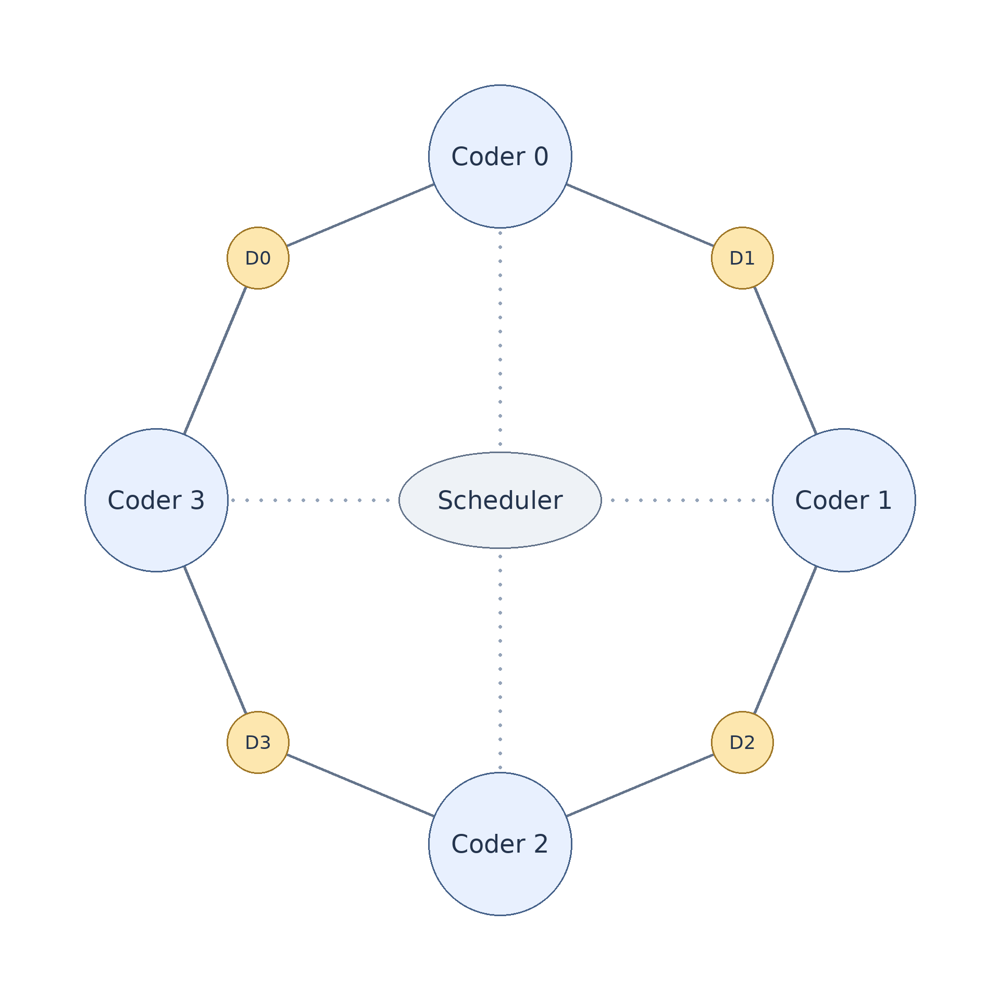
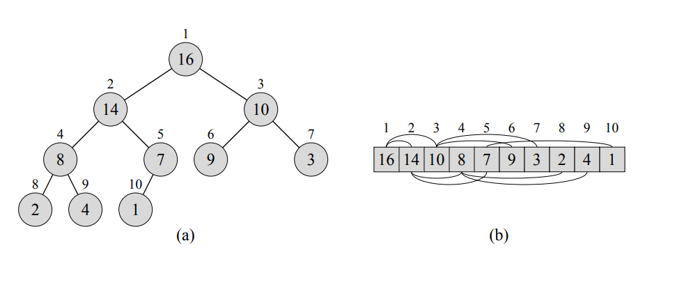

*This project has been created as part of the 42 curriculum by estarria.*

# Description

Codexion is a C simulation of coders who share USB dongles around a circular table. It explores synchronization, resource contention, and scheduling with POSIX threads.

Each coder repeats three tasks: compile, debug, and refactor. Compilation requires both adjacent dongles. After release, each dongle remains unavailable during its cooldown. A scheduler grants requests through FIFO or Earliest Deadline First (EDF) priority queues.

A separate monitor detects burnout. A coder burns out if the interval since their last compilation start reaches `time_to_burnout`. Before the first compilation, this interval starts at simulation startup. The simulation ends on burnout or after every coder completes the required number of compilations.



*Figure 1. Coders share their left and right dongles around the table. The central scheduler coordinates grants. This illustration uses zero-based labels. Program logs use coder IDs from 1 to N.*

# Instructions

The build requires `make`, a C compiler available as `cc`, and POSIX threads. The Makefile uses `-Wall -Wextra -Werror -pthread`.

Build and run the default example:

```bash
make run
```

For a custom simulation, build the executable first:

```bash
make
./codexion 5 800 200 200 200 3 100 fifo
```

All eight arguments are required, in this order:

```text
./codexion number_of_coders time_to_burnout time_to_compile time_to_debug time_to_refactor number_of_compiles_required dongle_cooldown scheduler
```

| Argument | Meaning |
| --- | --- |
| `number_of_coders` | Number of coder threads and dongles. |
| `time_to_burnout` | Maximum interval between compilation starts, in milliseconds. |
| `time_to_compile` | Compilation duration, in milliseconds. Both dongles remain occupied. |
| `time_to_debug` | Debug duration, in milliseconds. |
| `time_to_refactor` | Refactor duration, in milliseconds. |
| `number_of_compiles_required` | Completed compilations required per coder. |
| `dongle_cooldown` | Unavailable interval after release, in milliseconds. |
| `scheduler` | Exactly `fifo` or `edf`. |

Use positive integers for the seven numeric arguments. The current parser also requires a positive cooldown. Parameter choices can cause burnout, including the default example. With one coder, only one dongle exists, so compilation cannot start.

For a short EDF run with more time before burnout:

```bash
./codexion 5 5000 100 100 100 3 50 edf
```

Logs contain elapsed milliseconds, the coder ID, and the action. Each compilation has two dongle acquisition messages. Thread execution order varies between runs.

```text
0 1 has taken a dongle
0 1 has taken a dongle
0 1 is compiling
100 1 is debugging
```

For memory and synchronization diagnostics, install Valgrind and run:

```bash
# Memory errors and leaks
valgrind --leak-check=full --show-leak-kinds=all --error-exitcode=1 ./codexion 5 5000 10 10 10 3 5 fifo

# Mutex use and data races
valgrind --tool=helgrind --error-exitcode=1 ./codexion 5 5000 10 10 10 3 5 edf

# Additional synchronization diagnostics
valgrind --tool=drd --error-exitcode=1 ./codexion 5 5000 10 10 10 3 5 fifo
```

Instrumentation changes timing. These commands inspect memory and synchronization behavior.

Use `make clean` to delete object files, `make fclean` to delete the executable too, or `make re` to rebuild.

# Implementation decisions

Each coder has a thread. Two additional threads handle scheduling and monitoring. Coders submit requests through shared state rather than direct communication with their neighbors. Each dongle has its own heap of requests. The scheduler grants a coder access only when that coder leads both adjacent queues and both dongles are available.

The design uses one shared mutex for simulation state. This permits a single critical section to inspect both dongles and update their ownership.

## Thread synchronization mechanisms

`sim->mutex`, a `pthread_mutex_t`, protects dongle owners, cooldown timestamps, heaps, and mutable coder state. It also protects compilation counters, compilation timestamps, and the monitor's stop decision. Parameters and the simulation start time are initialized before thread creation.

A function with the `_locked()` suffix requires its caller to hold `sim->mutex`. The suffix documents an ownership rule. It does not acquire a lock. For example, `finish_compile_locked()` releases dongles and increments the compilation counter within the caller's critical section. The monitor reads that counter under the same mutex, so it cannot observe a partially completed update.

Each coder has a `pthread_cond_t`. The scheduler broadcasts on that condition after a grant. The monitor broadcasts after completion or shutdown. The wait in `wait_until_grant()` uses this predicate:

```c
while (granted && !sim->stop && coder->state != STATE_DONE
    && !owns_both_dongles_locked(coder))
    safe_cond_handle(&coder->cond, WAIT, &sim->mutex, NULL);
```

The wrapper calls `pthread_cond_wait()`. This operation releases the mutex and waits atomically, then reacquires the mutex before return. The loop reads the predicate again after every wakeup. A notification requests another inspection of state. It does not itself transfer dongle ownership.

`sim->sched_cond` notifies the scheduler when a request arrives, dongles are released, or the simulation stops. If a queued dongle has a future cooldown deadline, the scheduler uses `pthread_cond_timedwait()` with that absolute deadline. Otherwise, it waits for a notification. These conditions and protected predicates form the event protocol. There is no separate custom event object or spinlock.

`sim->log_mutex` protects each complete output operation. Log serialization preserves separate lines even when several coders report actions concurrently. An unprotected output sequence can produce a line such as this illustrative example:

```text
100 1 is deb100 2 is compiling
ugging
```

## Blocking cases handled

**Deadlock and Coffman conditions.** For distinct adjacent dongles, the scheduler reserves both in one critical section. A waiting coder holds neither dongle, which removes hold-and-wait and the corresponding circular resource dependency. Condition waits release the simulation mutex, so the scheduler can progress. With one coder, the same dongle cannot satisfy both hands. The monitor eventually reports burnout.

**Starvation and priority.** FIFO orders requests by arrival time. EDF orders them by burnout deadline: `last_compile_start + time_to_burnout`. Requests with equal keys have no defined order.

**Cooldown.** Release sets both ownership fields to zero and records `cooldown_until = now + dongle_cooldown` under the simulation mutex. The scheduler requires both ownership and cooldown checks to succeed before a grant. Its timed wait permits another attempt when cooldown expires, even without a new notification.

**Burnout and completion.** The monitor reads timestamps and counters under the simulation mutex, with approximately 1 ms between scans. It recognizes the compilation target before evaluating burnout for each coder. On termination, it sets `stop` and wakes scheduler and coder waiters. Timed work phases also inspect `stop` approximately every millisecond. The subject requires burnout output within 10 ms.

**Shutdown and logging.** Main joins threads before it destroys synchronization objects and frees arrays and heaps on the normal path. Log lines have a dedicated mutex.

# Binary min-heap

A priority queue stores requests with an ordering key and exposes the request with the highest priority. A min-priority queue places the smallest key first. It supports insertion, inspection of the minimum, and extraction of the minimum. Codexion needs these operations rather than a fully sorted collection.

A binary heap represents a complete binary tree in an array. In a min-heap, a parent precedes its children under the comparator. The root therefore contains the next request. The rest of the array is not fully sorted. With zero-based indices, the relationships are:

```text
parent(i) = (i - 1) / 2     for i > 0, using integer division
left(i)   = 2 * i + 1
right(i)  = 2 * i + 2
```



*Figure 2. A max-heap as (a) a tree and (b) an array, from Cormen et al., Introduction to Algorithms, Figure 6.1. Circles contain values. Labels identify one-based array indices. Curves show parent-child relationships. The tree has height three. The node at index 4, with value 8, has height one. Codexion uses zero-based indices and the reverse priority relation for a min-heap.*

Insertion appends a request, then moves it toward the root until the heap property holds. Extraction replaces the root with the last request, then moves that request downward. Each operation takes `O(log n)` time for `n` queued requests. Root inspection takes `O(1)` time.

In [heap_order.c](coders/heap_order.c), FIFO compares `arrival_ms` and EDF compares `deadline_ms`. Each entry also stores a coder ID. The scheduler uses that ID to match the roots of the two neighboring heaps. Pair insertion checks both capacities before changing either heap.

# Resources

Michael Kerrisk, *The Linux Programming Interface*, No Starch Press, 2010, pp. 661–669, provides the mutex reference. The [book's official site](https://man7.org/tlpi/) provides publication details and supporting material.

Thomas H. Cormen et al., *Introduction to Algorithms*, 2nd edition, MIT Press, pp. 151–170, provides the heap and priority-queue reference. The linked [third-edition text](https://www.cs.mcgill.ca/~akroit/math/compsci/Cormen%20Introduction%20to%20Algorithms.pdf) also covers these topics in Chapter 6 and contains Figure 6.1.

The linux documents [mutex operations](https://pubs.opengroup.org/onlinepubs/9699919799/functions/pthread_mutex_lock.html), [condition waits](https://pubs.opengroup.org/onlinepubs/9699919799/functions/pthread_cond_timedwait.html), and [broadcasts](https://pubs.opengroup.org/onlinepubs/9699919799/functions/pthread_cond_broadcast.html). OSTEP explains [shared state and threads](https://pages.cs.wisc.edu/~remzi/OSTEP/threads-intro.pdf) and [condition-variable predicates](https://pages.cs.wisc.edu/~remzi/OSTEP/threads-cv.pdf).

**AI use.** AI agents assisted with architecture study notes in, implementation review, architectural decisions brainstorming, heap implmentation and submission-audit material. Codex completed this README from the author's notes, source code, existing audit, and references. 

## Dictionary

**Critical section**: Code that accesses shared mutable data while the required mutex is held.

**Data race**: Conflicting accesses to the same memory from different threads, without synchronization, where at least one access writes.

**Mutex**: A synchronization primitive that permits one thread at a time to hold a lock and access protected data.

**Condition variable**: A primitive that lets threads wait for a protected predicate to change. A wakeup requires another inspection of the predicate.

**Predicate**: A statement about shared state that determines whether a thread can proceed.

**Interleaved execution**: Execution in which operations from different threads alternate. Their relative order can vary between runs.

**Log serialization**: Protection of output operations so that messages remain separate and complete.

**Deadlock**: A state in which threads cannot progress because each waits for a resource held by another.

**Starvation**: Indefinite delay of a request while other requests continue to receive service.

**Spinlock**. A lock that repeatedly attempts acquisition while the thread remains active. Codexion uses mutexes and condition waits instead.
